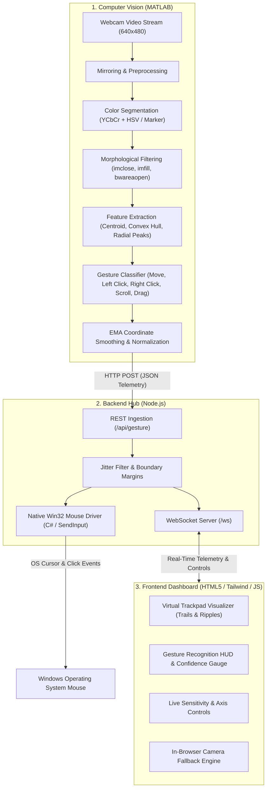

# AURA MOUSE // Hand Gesture Controlled Virtual Mouse

An end-to-end, real-time **Hand Gesture Controlled Virtual Mouse** system combining **MATLAB** for high-precision Computer Vision processing with a high-performance **Node.js** backend and a modern **Glassmorphism Web Dashboard** frontend.

---

## 🏗️ System Architecture



---

## 📁 Repository Structure

```text
Cv project/
├── matlab_cv/                       # Computer Vision core in MATLAB
│   ├── main_virtual_mouse.m         # Master CV script with real-time visualization & telemetry
│   ├── gesture_detector.m          # Hand morphology, radial peak extraction & gesture classifier
│   ├── skin_detector.m             # Dual-color space skin segmentation (YCbCr & HSV)
│   ├── color_marker_detector.m     # High-accuracy colored fingertip marker tracker (Blue, Green, Red)
│   ├── calibrate_color.m           # Interactive color threshold calibration tool
│   ├── test_connection.m          # Backend connectivity and roundtrip latency tester
│   └── README_MATLAB.md            # Detailed MATLAB setup and toolbox guide
├── backend/                         # Node.js backend & native mouse controller
│   ├── server.js                   # Express REST API & WebSocket broadcast hub
│   ├── mouseController.js          # Cursor smoothing (EMA), margin scaling & safety logic
│   ├── native_driver/
│   │   ├── MouseDriver.cs          # Ultra-fast C# Win32 SendInput driver
│   │   ├── MouseDriver.exe         # Pre-compiled high performance executable
│   │   └── build_driver.bat        # Recompile script using .NET Framework csc.exe
│   └── package.json                # Dependencies: express, ws, cors
├── frontend/                        # Cyber glassmorphism interactive dashboard
│   ├── index.html                  # Responsive UI with visualizer trackpad & gesture guides
│   ├── css/
│   │   └── style.css               # Neon glow effects, toggles, custom sliders
│   └── js/
│       ├── app.js                  # WebSocket client, settings synchronizer, event logging
│       ├── visualizer.js           # Canvas renderer with particle trails & action ripples
│       └── web_cv_fallback.js      # In-browser camera CV engine for immediate testing
├── start_project.bat               # 1-Click launcher for Windows
└── README.md                       # Master project documentation
```

---

## ✋ Hand Gestures & Action Mapping

| Gesture | Hand Pose | Action Executed | Description |
|:-------:|:---------:|:---------------:|:------------|
| **Move Cursor** | ☝️ 1 Finger Extended (Index) | `MOVE` | Moves the mouse cursor smoothly across the desktop screen with EMA jitter filtration. |
| **Left Click** | ✌️ 2 Fingers Joined / Pinch | `LEFT_CLICK` | Triggers a standard single left mouse click with cooldown debounce. |
| **Right Click** | 🤟 2 Fingers Spread (V-Sign) | `RIGHT_CLICK` | Triggers a right click (context menu). |
| **Scroll Up** | ✋ Open Palm Moving Up | `SCROLL_UP` | Scrolls the active document or web page upwards. |
| **Scroll Down** | ✋ Open Palm Moving Down | `SCROLL_DOWN` | Scrolls the active document or web page downwards. |
| **Drag & Drop** | ✊ Closed Fist | `DRAG` | Presses and holds the left mouse button; moving your hand drags the object until you release. |

---

## ⚡ Quick Start Instructions

### Option 1: One-Click Windows Launcher (Recommended)
Simply double-click the included batch script:
```cmd
start_project.bat
```
This automatically verifies the native driver, starts the Node.js backend on `http://localhost:8080`, and opens the dashboard in your default browser.

---

### Option 2: Manual Terminal Execution

#### 1. Start the Backend & Frontend Server
```bash
cd backend
npm install
node server.js
```
The server will output:
```text
=======================================================
 HAND GESTURE VIRTUAL MOUSE - BACKEND RUNNING
 Local Dashboard:  http://localhost:8080
 API Endpoint:     http://localhost:8080/api/gesture
 WebSocket:        ws://localhost:8080/ws
 Native Driver:    1536x864
=======================================================
```

#### 2. Run the Computer Vision Script in MATLAB
1. Open **MATLAB**.
2. Set the current folder in MATLAB to:
   ```matlab
   cd 'Cv project/matlab_cv'
   ```
3. (Optional) Run the connection test:
   ```matlab
   test_connection
   ```
4. Run the main computer vision loop:
   ```matlab
   main_virtual_mouse
   ```
5. A live dual-panel window will appear displaying:
   - **Left panel**: Raw video stream with tracked fingertip point, motion trail, bounding box, and HUD overlay.
   - **Right panel**: Segmented binary mask after morphological closing and hole filling.

---

## 💡 Standalone In-Browser Testing (No MATLAB Required)
If you do not have MATLAB open or wish to test the system immediately:
1. Open the dashboard at `http://localhost:8080`.
2. Click **"Browser Camera Test"** in the mode selector tab.
3. Click **"Start In-Browser Camera"**.
4. The built-in JavaScript computer vision engine will track your hand using your webcam and control the mouse cursor directly!
5. You can also click and drag anywhere on the **Virtual Monitor & Trackpad** to test mouse movement and actions manually.

---

## 🔬 Computer Vision Algorithm Details (MATLAB)

1. **Color Space Transformation**:
   - Frames are converted from standard RGB to **YCbCr** and **HSV**.
   - Skin segmentation model:
     $$\begin{aligned}
       133 \le C_r \le 175 &\quad\text{and}\quad 85 \le C_b \le 135 \\
       H \in [0.0, 0.15] \cup [0.85, 1.0] &\quad\text{and}\quad 0.15 \le S \le 0.75
     \end{aligned}$$
2. **Morphological Filtering**:
   - `bwareaopen` eliminates salt-and-pepper background noise below $500$ pixels.
   - `imclose` with a disk structuring element (`strel('disk', 5)`) smooths finger borders and bridges creases.
   - `imfill(..., 'holes')` seals internal palm cavities.
3. **Radial Boundary Peak Analysis**:
   - Computes Euclidean distance $R(k) = \sqrt{(x_k - C_x)^2 + (y_k - C_y)^2}$ from the contour boundary to the palm centroid $(C_x, C_y)$.
   - `findpeaks` identifies peaks exceeding $1.2\times$ average palm radius to accurately count extended fingers ($N_{\text{fingers}}$).
4. **EMA Coordinate Smoothing**:
   $$X_{\text{smooth}}^{(t)} = \alpha \cdot X_{\text{raw}}^{(t)} + (1 - \alpha) \cdot X_{\text{smooth}}^{(t-1)}$$
   Filters tremor and camera jitter while maintaining high responsiveness ($\alpha = 0.35$).
